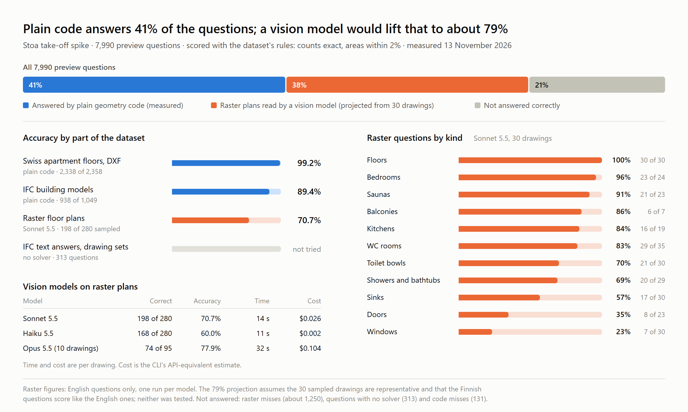

# Stoa take-off spike

Answers quantity take-off questions from the Junction 2026 Stoa dataset, and scores itself against
`questions.jsonl` using the dataset's rules (counts exact; areas, lengths and volumes within 2%).

- **Vector drawings** (DXF floor plans, IFC models) are answered by plain geometry code, with no model calls.
- **Raster floor plans** are read by a vision model through the local `claude` CLI.



## Run

```
python -m venv .venv
.venv\Scripts\pip install ifcopenshell
.venv\Scripts\python -I fetch_preview.py dataset README.md questions.jsonl "data/*/LICENSE.md" "data/swiss_dwellings/*.dxf" "data/ifc_models/*.ifc"
.venv\Scripts\python -I evaluate.py dataset --svg out
.venv\Scripts\python -I tests\test_core.py
```

`fetch_preview.py` reads the preview zip over HTTP range requests, so only the listed files are downloaded.
`--svg out` writes one evidence overlay per question kind: the plan with the counted or measured shapes highlighted.
Without `ifcopenshell` the IFC questions are skipped and everything else still runs.

### Raster floor plans

Needs the `claude` CLI on PATH, signed in. PowerShell:

```
.venv\Scripts\python -I fetch_preview.py dataset (Get-Content raster-sample.txt)
.venv\Scripts\python -I evaluate_raster.py dataset --models claude-sonnet-5-5 claude-haiku-5-5
```

`raster-sample.txt` lists the 30 drawings behind the raster figures above. Answers are cached under
`out/raster/<model>/`, so a re-run only asks about drawings it has not seen.

## Layout

| File | Role |
|---|---|
| `takeoff/questions.py` | question text (EN/DE/FR/IT) to a structured intent |
| `takeoff/swiss.py` | rooms, units, doors, windows and fixtures from a layered DXF plan |
| `takeoff/ifc.py` | room areas from IFC space geometry, element counts per storey |
| `takeoff/raster.py` | counts on a raster plan, asked of a vision model with a JSON schema |
| `takeoff/scoring.py` | counts exact; areas, lengths and volumes within 2% |
| `takeoff/evidence.py` | SVG overlay of the shapes behind an answer |

## Limits

- Raster results come from 30 drawings, English questions only, one run per model. Door and window counts are weak.
- Raster answers have no evidence overlay: the model returns counts, not locations.
- IFC-Bench text answers and the `opening_design` drawing sets have no solver.
- IFC wall lengths, side areas and volumes are not parsed.
- The DXF solver relies on the layer names and symbol shapes of the generated Swiss Dwellings files.

Drawings keep their own licences (`dataset/data/<source>/LICENSE.md`); `dataset/` is git-ignored.
