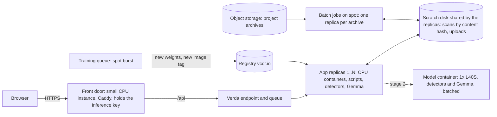

# From demo to real users: deploying and scaling Blueline on Verda

Blueline answers quantity questions about construction drawings with our own models only: geometry scripts for DXF and
IFC, two YOLO11 detectors (ONNX) for raster floor plans, and a 270M Gemma that reads the question. The models were
trained on Verda and everything runs on a CPU. This page says how that is deployed on Verda beyond one instance, what
triggers each step and what it costs. Numbers called measured were taken on our Verda instance on 14 November 2026
(23:30 to 00:10 UTC, method in the appendix); the rest is projection and says so. Prices are Verda's API prices of
15 November 2026, in EUR per hour.

## What has to scale

| Work | When | Cost on six cores (measured) |
|---|---|---|
| Geometry script (DXF, IFC) | every question on a vector drawing | DXF 2 to 10 ms; IFC 5 ms, 0.17 s for the first question on a model |
| Detector scan (both detectors, 1280 px) | once per raster drawing; cached by the content hash of the image | 1.8 s with all six cores busy |
| Interpretation (Gemma, one question at a time) | every question | 0.4 to 1.0 s with one user (the prompt up to the question is reused while the drawing stays the same); 1.1 s when questions about different drawings alternate |

No GPU is needed to answer, and a replica holds no state of its own: scans and uploads are files named by content
hash or a random id, written through a temporary file and a rename (`app/server/src/cache.ts`), so replicas can share
one disk.

## What one replica does today

One replica is the deployed app (commit 966ddab) on six pinned cores of the instance's EPYC 7643, with
`VISION_PROVIDER=none PLANNER_PROVIDER=gemma-local` and an empty cache. Users ask three dataset questions per drawing
and never share a drawing (100 raster, 60 DXF and 64 IFC drawings, in that mix). Each row is a two-minute run. A
training run was using the other cores, so the numbers are slightly pessimistic.

| Users asking at once | Interpreter reads every question: answers/min | median | p95 | Bulk mode (keyword parser): answers/min | median | p95 |
|---|---|---|---|---|---|---|
| 1 | 56.5 | 0.71 s | 2.5 s | 155.5 | 0.007 s | 2.1 s |
| 2 | 42 | 2.2 s | 5.6 s | | | |
| 4 | 38.5 | 4.9 s | 10.7 s | 177.5 | 0.18 s | 4.6 s |
| 8 | 39 | 10.6 s | 20.4 s | 176.5 | 2.0 s | 9.1 s |
| 16 | 34.5 | 21.3 s | 40.2 s | 147 | 5.4 s | 18.6 s |

No request failed. The server used 5.0 to 5.5 of its six cores in every row and at most 3.7 GB of memory. Latency
per drawing type is in the appendix.

**The interpreter saturates first, then the cores.** The Gemma answers one question at a time: on DXF drawings alone,
where everything else takes 2 ms, eight users got 54 answers/min. In bulk mode the limit is the scan: 30 raster
drawings/min, with one user or four. A replica is fastest with one request in flight. More in flight lowers
throughput (56 to about 40 answers/min), because the interpreter loses its reused prompt and because onnxruntime-node
1.31 runs a scan on Node's main thread, so the replica answers nothing else for those 1.8 s. Giving each model its own
cores (four detector threads, two interpreter threads) was worse: 29 answers/min at four users.

One setting had to change before this was worth measuring. ONNX Runtime sizes its thread pool from the machine (22
cores) and pins the threads itself, past any CPU limit. The deployed service, held to six cores by a quota, takes 7 to
8 s per scan; with six threads on six cores a scan takes 1.8 s. The table uses that setting,
`DETECTOR_THREADS=6`, which the demo now runs with too.

## The path



| Stage | Verda product, and why | Trigger | Capacity | Cost |
|---|---|---|---|---|
| 0. Today | One on-demand CPU instance (CPU.8V.32G: 8 vCPU, 32 GB) with the app as a service, held to six cores. During the hackathon the app rode along on the training A100. | | One replica, as above. | 0.086 EUR/h, about 62 EUR a month |
| 1. Replicas | Auto-scaling CPU containers (CPU Node, 8 vCPU, 32 GB) from the image we already build for the Hugging Face Space: one request per replica, queue load 1, at least one replica. The deployment's scratch disk, shared by its replicas, is mounted as the app's cache. A 4 vCPU instance stays as the front door, because a container endpoint needs a bearer key that a browser cannot hold. | A second user at the same time: with four, one replica's median answer takes 4.9 s instead of 0.7 s. | Per replica 40 answers/min with the interpreter, or 30 scans/min in bulk (measured on six cores). N replicas give N times that if the shared disk keeps up (projection). | 0.09 EUR/h per replica, 0.04 on spot. Always on, one replica and the front door: 96 EUR a month |
| 2. Model container | One GPU container (1x L40S) serving both detectors and the Gemma with batching, scaled on its own queue. App replicas stay on CPU with the scripts and the cache. | More than about 22 CPU replicas busy all the time (2.01 / 0.09 EUR): 900 answers/min or 670 scans/min. Or a first answer on a new drawing that must stay under 2 s. | Next table. | 2.01 EUR/h, 1.00 on spot |
| 3. Archives | Batch jobs on spot: one replica per request, gone when the process exits, with a deadline. After an eviction the retry finds the finished scans in the cache. | A customer hands over a whole project, not one drawing. | 10,000 raster drawings are 5.6 replica-hours on CPU at the measured 30 scans/min. `npm run eval` already answers in bulk: 37,584 DXF and 3,062 IFC questions scored (`app/README.md`). | 0.22 EUR on spot CPU for those 10,000 |

At one question per 30 s per active user (an assumption), a stage 1 replica kept at half load serves about 10 active
users: 100 active users are 10 replicas, 0.90 EUR/h.

The same models on a GPU, to size stage 2. The GPU is our A100, not an L40S, so stage 2 figures are projections.

| Model | Measured | How |
|---|---|---|
| Both detectors, one image at a time, FP16 | 106 ms per drawing (51 + 55), 9 drawings/s, under 1 GB | 48 dataset images at 1280 px, while a training run kept the GPU at 100% and 78 of 80 GB were taken |
| Both detectors, batch 16 | not measured | under 1.5 GB of GPU memory was free |
| Both detectors, batch 32, FP16 | 13.4 ms per drawing (5.9 + 7.5), 75 drawings/s | the validation pass that ends each model's training run, GPU not shared, from the logs |
| Gemma, batch 1 and batch 8 | 1.29 s per question; 4.2 questions/s; under 1 GB | 32 held-out prompts with transformers on the same shared GPU. Unbatched and shared, it is slower than the CPU |
| Gemma, batch 50 | 25 questions/s | 1,257 held-out prompts in 49.7 s after the fine-tune, from its log |

One GPU does the scans of about 19 CPU replicas shared and unbatched and of about 150 batched, and the interpreting
of about 28. It is the cheaper way to buy model throughput only above the 22-replica line; below it, it buys latency.

The split is small because the seams exist. Detectors sit behind `Detector` and language models behind `VisionModel`
(`app/server/src/models`). `RoboflowDetector` already calls a detector over HTTP, and `OpenAiCompatibleVision` already
talks to a vLLM-style server and can be chosen for the interpreter (`PLANNER_PROVIDER=openai-compatible`). Not
written: a detector provider for our own endpoint (the shape of `RoboflowDetector`, about 30 lines), an interpreter
provider that sends the prompt the Gemma was tuned on (`renderPrompt` in `gemma.ts`) with the call's JSON schema, and
the serving container. The pipelines and the router do not change.

**New drawing styles** come in the way the current models did: labels, the existing training queue on a spot burst
(eight runs on 8x L40S for four hours cost 29 EUR), an ONNX export, a new image tag, and the deployment's image set
to it. The cache key of a scan includes the weights' size and date, so a new model never answers from old scans.

## Cost per 1,000

At full use, from the measured rates and the prices above. A replica that is busy a quarter of the time costs four
times as much per drawing.

| | 1,000 raster drawings scanned | 1,000 questions answered |
|---|---|---|
| Outside vision model, one reading per drawing (measured, [gemini.md](gemini.md)) | $9 with Claude Sonnet 5.5; $18 to $70 with Gemini 4 Hydrogen, by thinking level | |
| The training A100, had it been kept for serving alone | 1.19 EUR | 0.89 EUR |
| Stage 1, CPU container | 0.05 EUR (30/min) | 0.04 EUR with the interpreter (40/min); 0.01 EUR in bulk (177/min) |
| Stage 2, L40S container (projection from the A100) | 0.06 EUR at the shared, unbatched rate; 0.01 EUR batched | 0.02 EUR (25 questions/s) |
| Stage 3, CPU container on spot | 0.02 EUR | 0.004 EUR in bulk |

On the same 200 held-out plans the outside models are also less accurate than our detectors: 77.1% and 85.1% of the
count questions against 85.9%.

## What stays true, and what is missing

With `VISION_PROVIDER=none` the code calls no model outside the process, at any stage, so a drawing stays on Verda's
machines in Finland. We have not confirmed in which location serverless replicas run.

Not built, and needed before real users:

- Accounts, with uploads and cache separated per customer. Today an upload is open to anyone who knows its random id.
- Upload limits and retention in the container. The instance has a 30 MB limit in Caddy and deletes uploads after a day.
- Inference off Node's main thread (or stage 2), so a replica answers during a scan.
- `/api/health` saying `busy` during a scan, which Verda's queue understands (it says `status: ok` today).
- Monitoring: queue length, replicas, latency per drawing type, the share of drawings the detectors do not recognise.
- The batch entry point: a request that names an archive, answers it, writes the result and exits.
- A licence for commercial use. The weights are non-commercial (Ultralytics AGPL-3.0, CubiCasa5k CC BY-NC-SA).

## Appendix

### Latency per drawing type (measured)

Median / p95 in seconds, for the first question on a drawing and for later ones.

| Mode, users | Raster first | Raster later | DXF first | DXF later | IFC first | IFC later |
|---|---|---|---|---|---|---|
| Interpreter, 1 | 2.45 / 3.33 | 0.39 / 0.78 | 1.02 / 1.41 | 0.59 / 0.77 | 1.61 / 2.33 | 0.96 / 1.25 |
| Interpreter, 2 | 5.03 / 6.21 | 1.68 / 2.32 | 2.01 / 4.09 | 1.81 / 5.63 | 2.55 / 5.74 | 2.29 / 5.31 |
| Interpreter, 4 | 8.24 / 11.97 | 3.80 / 6.86 | 7.06 / 8.76 | 4.68 / 10.70 | 7.49 / 9.97 | 4.36 / 10.99 |
| Interpreter, 8 | 14.41 / 23.66 | 8.54 / 16.13 | 14.17 / 19.13 | 8.50 / 20.38 | 15.30 / 22.44 | 8.75 / 21.83 |
| Interpreter, 16 | 26.40 / 43.09 | 18.34 / 36.46 | 28.60 / 40.17 | 18.06 / 40.28 | 33.13 / 38.63 | 16.33 / 36.67 |
| Bulk, 1 | 2.03 / 2.28 | 0.006 / 0.021 | 0.010 / 0.020 | 0.002 / 0.004 | 0.166 / 0.513 | 0.005 / 1.09 |
| Bulk, 4 | 3.66 / 5.92 | 0.182 / 3.71 | 0.017 / 3.83 | 0.006 / 0.728 | 1.88 / 4.21 | 0.014 / 4.22 |
| Bulk, 8 | 5.93 / 11.54 | 2.56 / 6.37 | 0.305 / 4.59 | 0.009 / 1.72 | 4.39 / 10.11 | 0.295 / 7.97 |
| Bulk, 16 | 10.35 / 22.79 | 5.86 / 12.42 | 3.11 / 12.95 | 0.024 / 2.10 | 12.72 / 23.39 | 4.24 / 19.50 |

Single pipelines, one-minute runs: raster only in bulk mode, 1 user 31.5 drawings/min (scan median 1.81 s) and
4 users 29 drawings/min; DXF only with the interpreter, 8 users, 54 answers/min (median 8.6 s); raster only with the
interpreter, 4 users, 16 drawings/min. A started server answers `/api/health` after 0.5 s (files already in the page
cache); the models load on the first question, which then takes 5.3 to 5.7 s on a raster drawing, 1.0 s on DXF and
2.3 s on IFC.

### Repeat the load test

On the instance, as root. The server and the generator share cores 16 to 21 and end by themselves.

```bash
mkdir -p /data/scale-test/home && cp -ax /srv/blueline/repo /data/scale-test/repo   # -x leaves the demo's cache behind
cd /data/scale-test/repo/app && chown nobody .cache /data/scale-test/home
runuser -u nobody -- env HOME=/data/scale-test/home HOST=127.0.0.1 PORT=18790 STOA_DATASET=/srv/blueline/dataset \
  VISION_PROVIDER=none DETECTOR=onnx RASTER_DETECTOR_TARGETS=all RASTER_SYMBOL_VOTE=off \
  PLANNER_PROVIDER=gemma-local PLANNER_THREADS=6 DETECTOR_THREADS=6 \
  timeout 400 taskset -c 16-21 /srv/blueline/node/bin/node --import tsx server/src/server.ts &
timeout 300 taskset -c 16-21 /srv/blueline/node/bin/node ../deploy/verda/loadtest.mjs --url http://127.0.0.1:18790 \
  --dataset /srv/blueline/dataset --users 4 --seconds 120 --pid "$(ss -ltnp 'sport = :18790' | grep -o 'pid=[0-9]*' | cut -d= -f2)"
```

Add `INTERPRETER=templates` to the server for bulk mode, `--kinds raster` or `--kinds dxf` to the generator to load
one pipeline, and empty `.cache` and restart the server between runs. Without `DETECTOR_THREADS` the detectors' threads
leave the six cores (measured: 11 cores in use). The generator is `deploy/verda/loadtest.mjs`, plain Node.

### The stage 1 deployment

Nothing below was created; it is specified from Verda's API schema (`api.verda.com/v1/openapi.json`) and docs.

```bash
# image: the bundle of the Hugging Face Space, with the interpreter file in models/interpreter
python -I deploy/hf-space/build_bundle.py dataset-full .hf-space-build
docker build -t vccr.io/<PROJECT_ID>/blueline:<TAG> .hf-space-build
echo '<SECRET>' | docker login vccr.io/<PROJECT_ID> -u 'vcr-<PROJECT_ID>+<CREDENTIALS_NAME>' --password-stdin
docker push vccr.io/<PROJECT_ID>/blueline:<TAG>

# deployment: POST /v1/container-deployments with deploy/verda/container/deployment.json (fill in the three <...>)
cd training && python -c "import json, verda; print(json.dumps(verda.call('POST', '/container-deployments', json.load(open('../deploy/verda/container/deployment.json')), token=verda.login()), indent=1))"
python verda.py raw GET container-deployments/blueline-api/status
```

`deployment.json` asks for: compute `CPU Node` size 8; replicas 1 to 8; one concurrent request per replica; queue load
threshold 1; scale-up delay 0 s, scale-down delay 300 s; request time to live 300 s; port 7860; health check on
`/api/health`; the environment of the service on the instance; and the scratch disk mounted at
`/home/node/space/app/.cache`. The answer carries `endpoint_base_url`; the front door proxies `/api/*` to it with
`Authorization: Bearer <inference key>`.

Not confirmed without running it:

- Whether a health probe tolerates a replica that is silent for a second during a scan.
- Whether the scratch disk can be mounted at that path and written by uid 1000, and how it behaves with several writers.
- How many cores a `CPU Node` replica shows to the process: `PLANNER_THREADS` and `DETECTOR_THREADS` should equal it.
- The cold start of a new replica: the image is about 2.5 GB unpacked and its pull time is undocumented.
- Whether the API accepts a disabled `gpu_utilization` trigger on CPU compute (the schema requires the field).
- That an 8 vCPU replica does at least what our six cores did.
