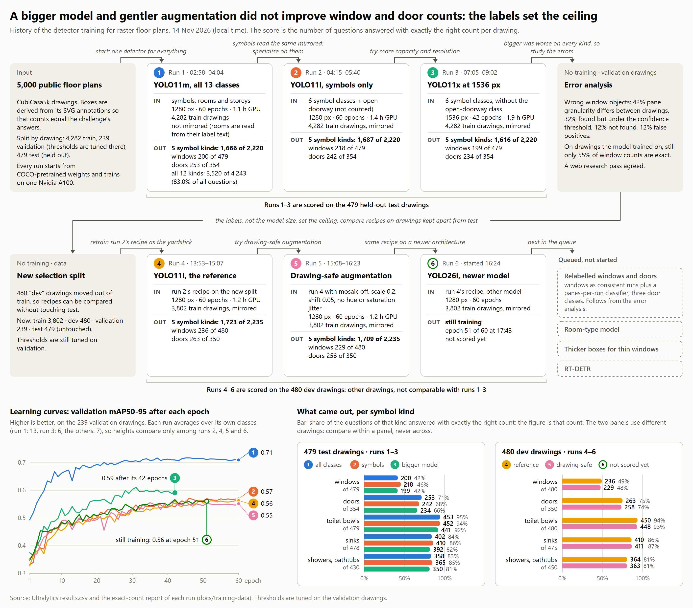

# What we built on Verda

Blueline is our entry for the Stoa challenge at Junction 2026: ask a quantity question about a construction drawing
and get the answer with every counted item marked on the drawing, so a person can check it. Vector drawings (CAD, IFC)
are answered by exact geometry code. For raster floor plans we needed models of our own, and those exist because of
Verda: we trained them there, we fine-tuned the small model that interprets questions there, and the public demo runs
there.

Live demo, served from a Verda instance: https://blueline.65-108-33-91.sslip.io

## What ran on Verda, and why that product

| Product | What we did with it | Why this one |
|---|---|---|
| GPU instance, on demand (1x A100 80 GB, FIN-01) | The home of the project: 31 GB of data, the environment and a training queue. Nine detector runs, the fine-tune of the question interpreter (a 270M Gemma on 53,632 question-to-call pairs, three epochs in about 90 minutes), and a served Gemma 4 for comparison. | It has to stay up for two days and must not disappear mid-run. |
| Spot instance, 8x L40S (FIN-01, 7.30 EUR/h) | Eight training runs side by side for four hours: three seeds of the reference recipe, two room-type models, the relabelled windows on a second architecture, RT-DETR, an all-class model. | Half the price of on demand. Same datacentre as the A100, so 19 GB of data arrived in about three minutes. Runs are independent, so an eviction costs one run, not the batch. |
| The same GPU instance as a web host | The demo: a Node server with our ONNX detectors on the CPU and the interpreter, in a sandboxed service capped at six cores, behind HTTPS. | No small CPU instance was available when we deployed. One script moves the demo to one (0.04 EUR/h) when it is. |

Looked at and not used: cloning the data volume (the source instance must be shut down first), the serverless container
template for Gemma 4 and managed inference (not needed once the measurements were in), object storage.

## What the compute bought

Measured on 200 floor plans held out from training, 1,781 count questions, exact counts only:

| Who answers | Right | Hosted vision calls |
|---|---|---|
| A hosted vision model alone (Sonnet 5.5) | 77.1% | 1 per drawing |
| Our detectors alone, trained on Verda | 85.9% | none |
| Our detectors for drawn symbols, Gemini 4 for room types | 87.7% | 1 per drawing, only for room types |

The spot burst also told us what not to spend on. Three seeds of one recipe differ by about 13 questions in 2,235, and
a larger model, a newer architecture, RT-DETR, gentler augmentation and thicker boxes all landed inside that noise. The
limit for windows is the annotation itself: the same window is one object in some drawings and two in others. Labelling
windows as runs gained 19 of 480 drawings on our selection set; the fair retrain that settles it is running now.

The interpreter went from no valid output to 87% of held-out questions turned into exactly the right call. Inside the
app it matches a hosted small model on the dataset's wording and answers in about a second on a laptop CPU. A served
Gemma 4 31B as a vision model, by contrast, scored 58.6% through Google's API on the same drawings, below our
detectors, so we did not adopt it.

## How we worked

- Every run is in the ledger in [training/README.md](../training/README.md) with what went in, what came out and what
  it led to; the logs behind the figure are in [docs/training-data](training-data).
- [training/verda.py](../training/verda.py) creates, lists and deletes instances through the API, spot included.
  A queue on the instance runs one experiment per GPU and scores it; the spot box copied results and the latest
  checkpoint back to the A100 every two minutes.
- An expensive instance never exists without a deletion timer that does not depend on anyone being awake. The burst
  was created with its deletion already scheduled, and it was gone on time with its volume.
- [training/RESEARCH.md](../training/RESEARCH.md) is the plan the later runs followed, with a reviewer's objections.
- [deploy/verda](../deploy/verda) sets up and redeploys the demo.

Things that went wrong, for the next team: our first delete call failed because the API lists the system volume twice,
and the instance idled for three hours; the coupon cannot start an instance until a payment method is on file; the API
quotes prices in USD unless asked for EUR; small CPU instances were unavailable when we wanted one.

## Cost

About 77 EUR of the 200 EUR coupon by the early hours of 15 November: roughly 47 EUR for the A100 over 21 hours and 29 EUR
for the four-hour spot burst.

## From demo to real use

Answering needs no GPU and no call outside the process, so a drawing stays on Verda's machines. Measured on six cores
of our instance with our own models only, one replica scans 30 raster drawings a minute (1.8 s each, once per drawing)
and gives 56 answers a minute to one user and about 40 when several ask at once; the interpreter, which reads one
question at a time, saturates first. The path from there is the same container image as auto-scaling CPU containers
behind one queue with a shared cache (0.09 EUR per replica-hour, about 0.05 EUR per 1,000 drawings against $9 through
an outside vision model), then one GPU container for the models once more than about 22 CPU replicas are busy (the
same models ran at 9 to 75 drawings a second on the A100), and batch jobs on spot capacity for whole-project archives.
The measurements, the costs, what is not built yet and the container specification are in [scaling.md](scaling.md).
