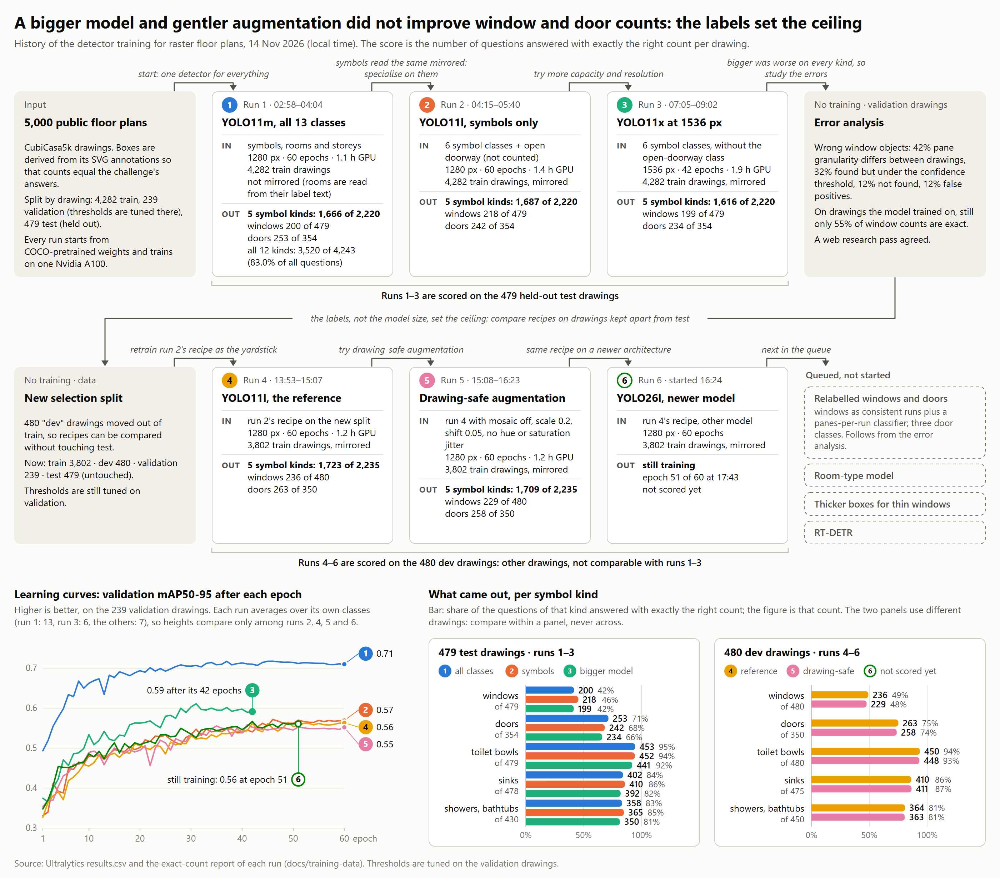

# Training a detector for the raster floor plans

Stoa's raster questions (`data/cubicasa5k/*.png`) come with counts only. The drawings are the public CubiCasa5k
set, whose SVG annotations give a box for every window, door, fixture and room. This folder turns those
annotations into detection labels that follow the wording of Stoa's questions, trains a detector on a GPU
instance, and scores it by exact count on drawings held out from training.

## Training history



The figure shows every detector run in the order it happened: what it was trained on, why it followed from the
step before, its validation mAP50-95 per epoch, and the exact counts it reached per symbol kind. Runs 1–3 are
scored on the test drawings and runs 4–6 on the dev drawings, so the two groups are drawn apart.
To redraw it from the logs saved in `docs/training-data/` (one `results.csv` per run and `runs.json`):
`.venv/Scripts/python.exe -I docs/make_training_figure.py`, then `node docs/render_training_figure.mjs`.

### Run ledger

All runs are on one Nvidia A100 on Verda (14 November 2026, local time), starting from COCO-pretrained weights.
Scores are questions answered with exactly the right count over the five symbol kinds; runs 1–3 on the 479 test
drawings, runs 4–6 on the 480 dev drawings.

| Run | When | Model | Trained on | Size, epochs | GPU time | Result | Led to |
|---|---|---|---|---|---|---|---|
| 1 | 02:58–04:04 | YOLO11m | all 13 classes, 4,282 drawings, not mirrored | 1280 px, 60 | 1.1 h | 1,666 of 2,220 (all twelve kinds: 3,520 of 4,243) | a detector specialised on symbols |
| 2 | 04:15–05:40 | YOLO11l | 6 symbol classes + open doorway, mirrored | 1280 px, 60 | 1.4 h | 1,687 of 2,220 | trying more capacity and resolution |
| 3 | 07:05–09:02 | YOLO11x | 6 symbol classes, mirrored | 1536 px, 42 | 1.9 h | 1,616 of 2,220, worse on every kind | the error analysis: the labels set the ceiling |
| 4 | 13:53–15:07 | YOLO11l | run 2's recipe on the new split (3,802 drawings) | 1280 px, 60 | 1.2 h | 1,723 of 2,235 | the yardstick for later runs |
| 5 | 15:08–16:23 | YOLO11l | run 4 with mosaic off and gentler scaling and colour | 1280 px, 60 | 1.2 h | 1,709 of 2,235, no gain | dropping augmentation as a lever |
| 6 | from 16:24 | YOLO26l | run 4's recipe | 1280 px, 60 | running | not scored yet | |

Per run, `docs/training-data/` holds the per-epoch log (`runN.csv`), the exact settings Ultralytics recorded
(`runN-settings.yaml`) and the scoring report with per-kind counts and the confidence thresholds tuned on validation
(`runN-report.json` for runs 1–3, `runN-result.json` for the queue runs). The raw console logs are not kept here.
The GPU instance cost 2.14 EUR per hour; the account balance went from 200 EUR to 167.67 EUR by 17:20.

## Data and labels

- CubiCasa5k: Zenodo record 2613548 (`cubicasa5k.zip`, CC BY-NC-SA 4.0). Stoa's PNG is CubiCasa's `F1_original.png`;
  the SVG is in the coordinates of `F1_scaled.png`, so boxes are scaled by the size ratio.
- Classes: window, door (doorways with a leaf), toilet, sink, shower, bathtub, sauna, kitchen, bedroom, wc_room,
  bathroom, balcony, floor.
- `remote/agreement.py` checks each counting rule against Stoa's answers; `remote/build_dataset.py` prints the
  agreement per question kind before it writes the dataset.
- Splits are by drawing with a fixed seed: 10% test (always containing the 30 drawings of `raster-sample.txt`),
  5% validation, the rest train. The 213 CubiCasa plans that Stoa does not include are added to train.
  The lists are in `splits/`.

## Commands (on the instance, from /data)

```
bash setup.sh                                   # tools, Python env, both datasets
venv/bin/python parse_svg.py                    # SVG annotations -> /data/feat/features.jsonl
venv/bin/python build_dataset.py                # agreement report, YOLO dataset in /data/yolo
venv/bin/python train.py m1280 yolo11m.pt 1280 60 16
venv/bin/python eval_counts.py runs/m1280/weights/best.pt 1280
venv/bin/python export_onnx.py runs/m1280/weights/best.pt 1280 <name>
```

`verda.py` (run locally) lists instance types and creates or deletes the instance through the Verda API.
Credentials are read from `~/.ssh/verda_stoa_api.json`, never from the repo.
`verda.py delete <instance-id> [volume-id ...]` deletes the instance, then its volumes permanently, and prints
`DELETED_OK` (exit 0) only when a fresh listing shows none of them, trash included; it can be repeated.

## Scoring

`eval_counts.py` tunes one confidence threshold per class on the validation split, then applies them unchanged to
the test split and counts a question as right only when the detector's count equals Stoa's answer.
With `part=dev` it scores the dev drawings of a sweep dataset instead and never reads the test split. Either way
every detection (class, score, box) is saved per drawing next to the report, as `val.json` and `<part>.json`.

## Comparing recipes: the sweep split and queue

239 validation drawings cannot separate two recipes, and test is for the final measurement only. `remote/sweep/`
therefore keeps a third part:

- `build_sweep.py` writes variants of the datasets under `/data/sweep/data` in which 480 train drawings (fixed
  seed, all with Stoa answers; `splits/dev.txt`) form a `dev` part and the remaining 3802 (`splits/sweep-train.txt`)
  are train. Validation and test are unchanged. Variants: `yolo` (13 classes), `yolo_sym` (symbols), `yolo_sym_thick`
  (windows and doors grown to 2.5% of the image's shorter side on their short side), `yolo_wd` (window, door,
  doorway), `yolo_rooms` (room types and storeys).
- An experiment is `run_all.sh` with `STOA_OUT=/data/sweep STOA_PART=dev`: train, tune thresholds on validation,
  score exact counts on dev, save the detections.
- `submit.py <batch.json>` queues experiments (see `batch1.json` for the format) and starts one `worker.py` per GPU;
  each worker runs one experiment at a time with `CUDA_VISIBLE_DEVICES` set and writes
  `/data/sweep/results/<name>.json`. A failed run gets a result file too and does not hold up the queue.
- `status.py` prints the queue and `ALL_DONE` when it is empty. `batch_status.py <names>` does the same for runs
  spread over two instances, with `push.sh` copying results from a short-lived instance to the long-lived one.

```
venv/bin/python sweep/build_sweep.py
venv/bin/python sweep/submit.py sweep/batches/batch1.json
venv/bin/python sweep/status.py
rm sweep/queue/pending/<name>.json              # take an experiment out of the queue before it starts
```

## Licences

Ultralytics YOLO is AGPL-3.0. CubiCasa5k is CC BY-NC-SA 4.0, so weights trained on it are for non-commercial use.
